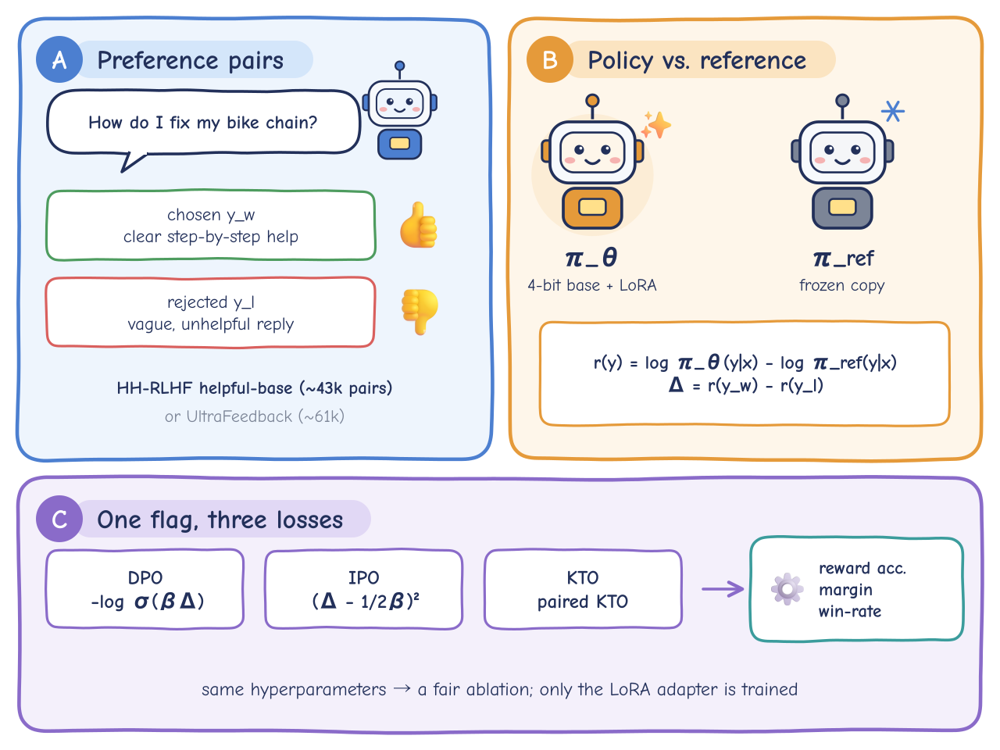
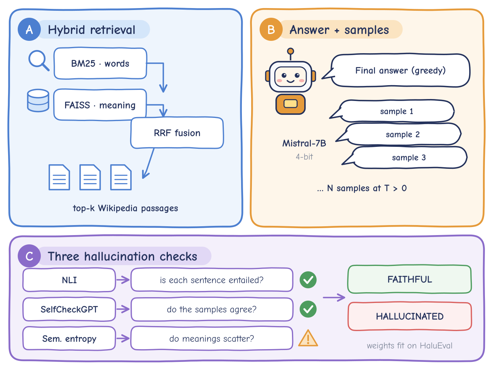
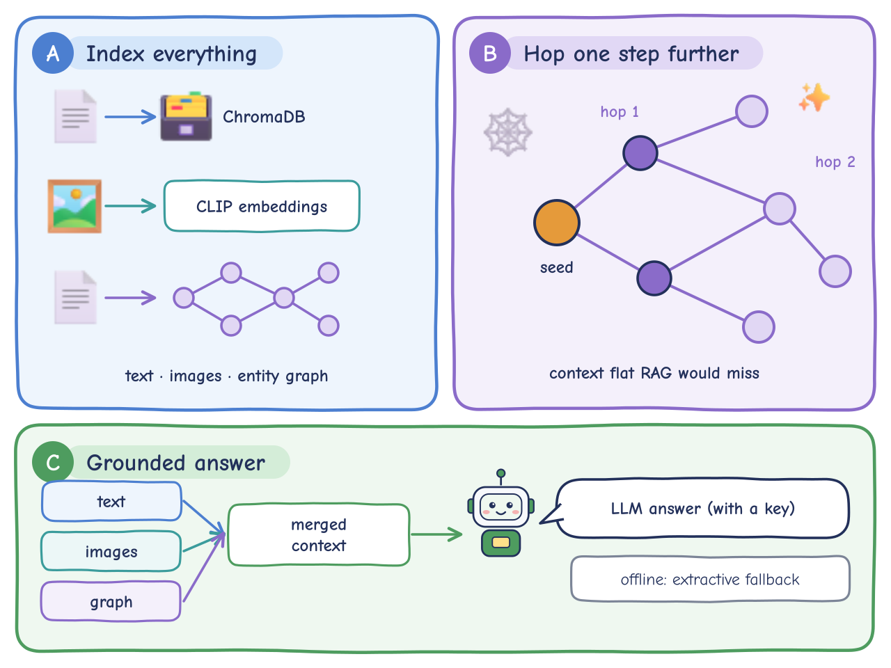
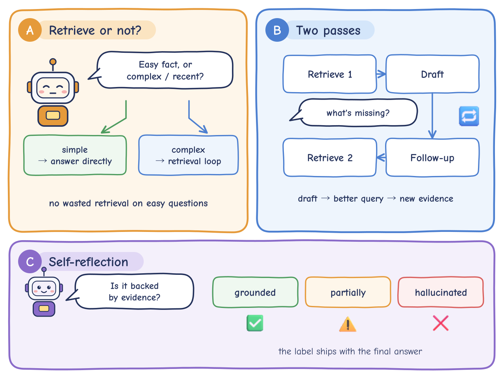
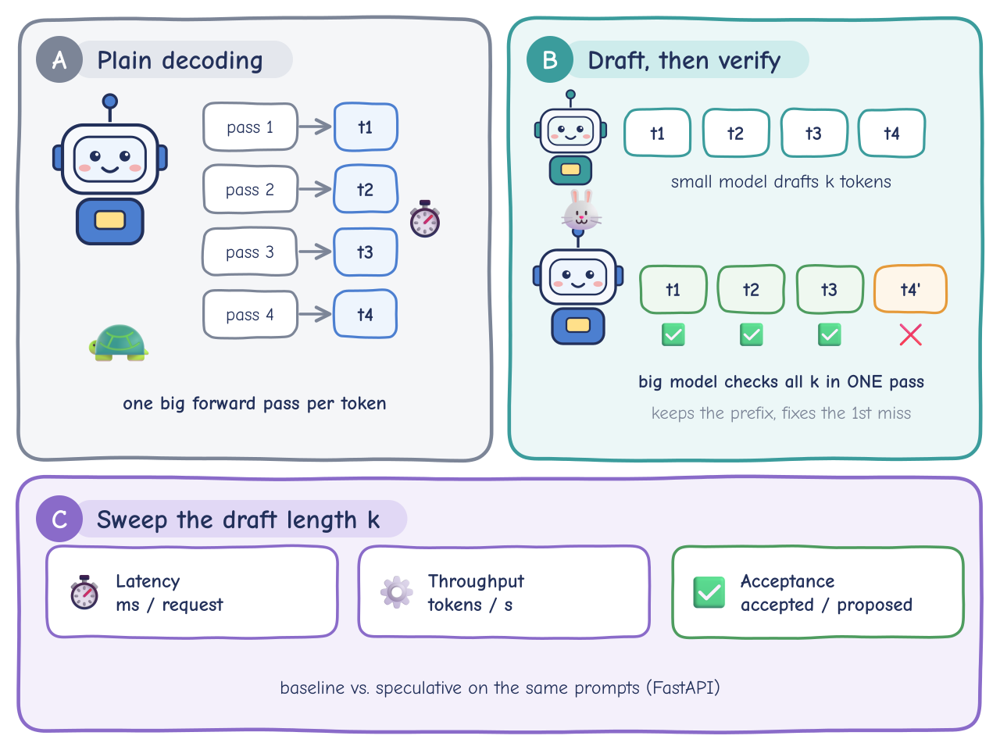
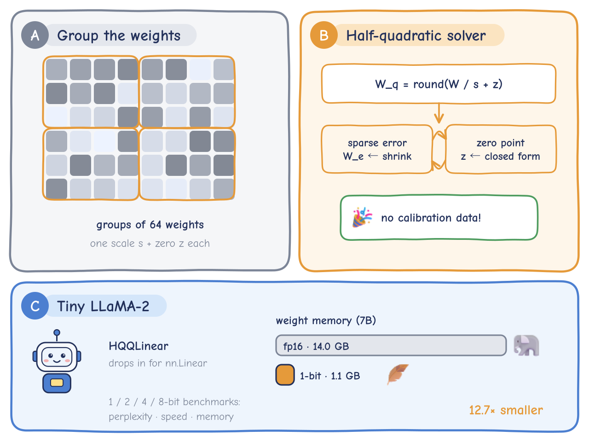
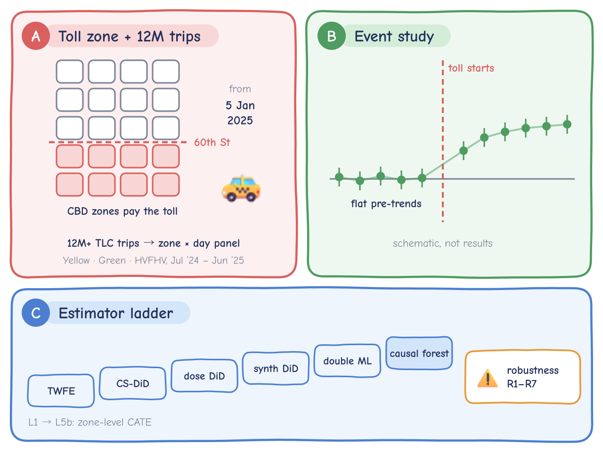
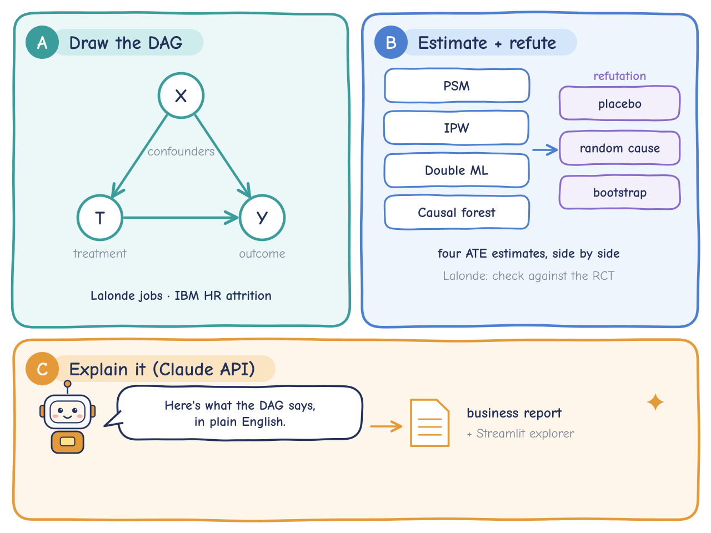

# 🤖 LLM & DS Projects

  <a href="/" style="display:inline-block;padding:7px 14px;border:1px solid rgba(0,0,0,0.12);border-radius:999px;text-decoration:none;">
    ← Back to Home
  </a>

Side projects in LLM systems and applied causal inference. Each one comes with a small overview figure of how it works, and the code is linked.

  

    

      № 01
      ALIGNMENT
      
    

    

      
LLM alignment

      
AlignDPO

      
Preference fine-tuning of Mistral-7B with three swappable losses.

      
Fine-tunes Mistral-7B-Instruct on Anthropic HH-RLHF (or UltraFeedback) with QLoRA: a 4-bit NF4 base, trainable LoRA adapters and a frozen reference model. DPO, IPO and KTO are written from scratch and switched by one config flag, so a controlled ablation compares them under identical hyperparameters, tracked by reward accuracy, reward margin and GPT-4 win-rate.

      
DPOIPOKTOQLoRAMistral-7BW&amp;B

      
<a class="proj-btn" href="https://github.com/olivia3395/llm-projects/tree/main/AlignDPO">&lt;/&gt; Code</a>
    

    

  

  
❦

  

    

      № 02
      EVALUATION
      
    

    

      
Hallucination detection

      
RAGAudit

      
Open-domain QA that audits every answer before trusting it.

      
Hybrid BM25 + FAISS retrieval, fused by reciprocal rank, feeds a 4-bit Mistral-7B. Each answer then passes three detectors: sentence-level NLI entailment (DeBERTa), SelfCheckGPT consistency across sampled answers, and semantic entropy over meaning clusters. Their scores are combined with weights calibrated on HaluEval, and the pipeline is benchmarked on Natural Questions.

      
BM25FAISSRRFNLISelfCheckGPTsemantic entropy

      
<a class="proj-btn" href="https://github.com/olivia3395/llm-projects/tree/main/RAGAudit">&lt;/&gt; Code</a>
    

    

  

  
❦

  

    

      № 03
      RETRIEVAL
      
    

    

      
Multimodal retrieval

      
GraphRAG

      
Retrieval that follows the graph one hop further.

      
Combines dense text retrieval (sentence-transformers + ChromaDB), CLIP image–text search and entity-graph expansion in one FastAPI service. The graph route pulls in second-hop context that flat chunk retrieval misses. Answers are synthesized by an LLM when a key is configured, with an extractive fallback that runs fully offline.

      
entity graphCLIPChromaDBFastAPI

      
<a class="proj-btn" href="https://github.com/olivia3395/llm-projects/tree/main/GraphRAG">&lt;/&gt; Code</a>
    

    

  

  
❦

  

    

      № 04
      RETRIEVAL
      
    

    

      
Query routing

      
Adaptive RAG

      
Decides when to retrieve, how often, and whether to trust the answer.

      
A classifier answers simple factual questions directly and sends complex or time-sensitive ones through two retrieval passes, with a follow-up query written from the first draft. A self-reflection step labels the final answer as grounded, partially grounded or hallucinated. It runs offline by default with TF-IDF retrieval; dense embeddings and an OpenAI model are optional.

      
query routingiterative retrievalself-reflectionFastAPI

      
<a class="proj-btn" href="https://github.com/olivia3395/llm-projects/tree/main/Adaptive-RAG">&lt;/&gt; Code</a>
    

    

  

  
❦

  

    

      № 05
      INFERENCE
      
    

    

      
Speculative decoding

      
DraftVerify

      
A small model drafts, a large model verifies.

      
A speculative-decoding engine with a benchmark harness. The draft model proposes k tokens, the target model checks them in one forward pass, the matching prefix is accepted and the first mismatch is replaced by the target's token. Sweeps over the draft length measure latency, throughput and acceptance rate against plain autoregressive decoding.

      
draft–verifyacceptance ratelatencyFastAPI

      
<a class="proj-btn" href="https://github.com/olivia3395/llm-projects/tree/main/DraftVerify">&lt;/&gt; Code</a>
    

    

  

  
❦

  

    

      № 06
      INFERENCE
      
    

    

      
Low-bit quantization

      
HQQ

      
Calibration-free 1–8 bit quantization of LLaMA-2, from scratch.

      
Implements Half-Quadratic Quantization: grouped weights get a per-group scale and zero point, refined by a proximal solver that alternates a sparse error update with a closed-form zero-point step, with no calibration data. HQQLinear drops in for nn.Linear, and benchmarks cover perplexity, decoding speed and memory; 1-bit weights take 12.7× less memory than fp16.

      
HQQW1–W8proximal optimizationLLaMA-2

      
<a class="proj-btn" href="https://github.com/olivia3395/llm-projects/tree/main/HQQ-Quantization">&lt;/&gt; Code</a>
    

    

  

  
❦

  

    

      № 07
      CAUSAL
      
    

    

      
Policy evaluation

      
Congestion Pricing

      
What New York's congestion toll did to demand, fares and trip geography.

      
Builds a zone × day panel from 12M+ NYC TLC Yellow, Green and HVFHV trips (July 2024 – June 2025) around the toll that started on 5 January 2025. The estimates climb a six-step ladder, from TWFE and Callaway–Sant'Anna event studies to continuous-dose DiD, synthetic DiD, double ML and causal forests for zone-level effects, with placebo, anticipation and leave-one-out robustness checks.

      
CS-DiDsynthetic DiDdouble MLcausal forestDuckDB

      
<a class="proj-btn" href="https://github.com/olivia3395/data-science-portfolio/tree/main/causal-inference/Congestion-Pricing">&lt;/&gt; Code</a>
    

    

  

  
❦

  

    

      № 08
      CAUSAL
      
    

    

      
LLM-augmented causal inference

      
CausalLens

      
Causal estimates with a plain-English report attached.

      
Takes a tabular dataset through a DoWhy causal DAG, four ATE estimators (propensity matching, IPW, double ML, causal forest) and refutation tests, then uses the Claude API to explain the graph and write a business report. It is validated on Lalonde, where the observational estimates can be checked against the experimental benchmark, and applied to IBM HR attrition.

      
DoWhyEconMLrefutationClaude APIStreamlit

      
<a class="proj-btn" href="https://github.com/olivia3395/data-science-portfolio/tree/main/causal-inference/CausalLens">&lt;/&gt; Code</a>
    

    

  

